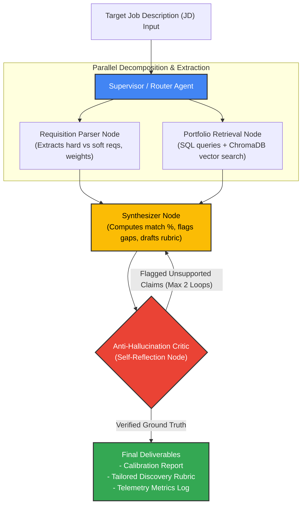

<div align="center">

# 🎯 AuditFlow
### Enterprise Multi-Agent Talent & Requisition Calibration Platform

[](https://www.python.org/)
[](https://github.com/langchain-ai/langgraph)
[](https://www.trychroma.com/)
[](https://aistudio.google.com/)
[](https://huggingface.co/)
[-brightgreen.svg)]()
[](LICENSE)

*An enterprise-grade multi-agent system featuring cyclic self-reflection, hybrid RAG (structured SQLite + dense vector store), and granular LLM-native telemetry. Architected to automate technical talent calibration against complex job requisitions and generate personalized technical discovery interview rubrics.*

[Key Features](#-key-features) • [Google FDE Alignment](#-google-fde-alignment-matrix) • [Architecture](#-system-architecture) • [Quickstart](#-quickstart-0-cost) • [Verification Suite](#-automated-verification-suite)

</div>

---

## 💡 The Problem
In enterprise engineering hiring (e.g., Forward Deployed Engineering, Strategic AI Solutions), automated screeners either rely on brittle keyword matching or hallucinate credentials when summarizing unstructured resumes. 

**AuditFlow** solves this by enforcing a **two-sided ground truth constraint**:
1. **Relational Fact Verification:** Every hard qualification (GPA, years of experience, proven programming languages, competitive percentiles) is queried strictly from an ACID-compliant structured database (`SQLite`).
2. **Semantic Architectural Retrieval:** Deep project implementations, streaming latency numbers, and case studies are retrieved via dense vector similarity (`ChromaDB`).
3. **Cyclic Self-Reflection (Anti-Hallucination):** A dedicated Critic Agent audits the evaluation draft against ground-truth database records before emitting deliverables, looping back to re-synthesize if any uncorroborated claim is detected.

---

## 🎯 Google FDE Alignment Matrix

| Target JD Qualification | How AuditFlow Implements It |
| :--- | :--- |
| **Structured & Unstructured Data Pipelines** | **Structured (SQLite):** Relational store containing verified candidate skills, project impact metrics, LeetCode/Codeforces percentiles, and academic records.<br>**Unstructured (ChromaDB):** Dense vector store containing architectural case studies, system design docs, and target job descriptions. |
| **Multi-Agent Systems & LangGraph** | **Hierarchical Delegation:** Supervisor routes execution to specialized workers (ReqParser, PortfolioRetriever, Synthesizer, Critic).<br>**Cyclic Self-Reflection:** Anti-Hallucination Critic audits the synthesized deliverable and triggers a revision loop if any claim is unbacked by ground truth.<br>**ReAct / Tool Calling:** Agents invoke parameterized SQL tools and semantic vector search tools. |
| **LLM-Native Metrics & Observability** | In-flight telemetry tracking **Tokens/Second throughput**, **Time-To-First-Token (TTFT)**, **Latency waterfalls**, and **simulated vs actual cost ($0.00 on Free Tier)**. |
| **Technical Discovery Alignment** | Generates an **Interview Discovery Rubric** with probing architectural questions directly calibrated against the candidate's real engineering projects. |

---

## 🏗️ System Architecture



### The 4 Specialized LangGraph Agents

1. **Supervisor Agent:** Root hierarchical controller. Manages state initialization, session threads, and dispatches sub-tasks.
2. **Requisition Parser Agent:** Decomposes complex multi-paragraph job specifications into prioritized technical constraints, minimum vs preferred thresholds, and scoring categories.
3. **Portfolio Retriever Agent (Hybrid RAG):** Fuses relational table scans (`skills`, `projects`, `assessments`) with dense vector cosine similarity over unstructured markdown case studies.
4. **Synthesizer Agent:** Analyzes the delta between candidate evidence and requisition demands, computes calibrated fit scores (0-100%), and designs high-signal technical discovery questions.
5. **Anti-Hallucination Critic (Self-Reflection):** Evaluates the synthesizer's claims against ground-truth database rows. If a claim lacks proof (e.g. attributing unverified tools or inflated experience), it injects corrective feedback and activates the cyclic reflection edge.

---

## ⚡ Zero-Cost ($0.00) Production Stack

* **LLM Engine:** Google Gemini API (`gemini-2.0-flash` or `gemini-1.5-flash`) via the official `google-genai` SDK (Free Tier).
* **Embeddings:** Hugging Face Serverless Inference API (`sentence-transformers/all-MiniLM-L6-v2`) — eliminates local PyTorch/Torch memory overhead.
* **Relational Storage:** Python standard library `sqlite3` (zero setup, ACID compliant).
* **Vector Store:** Embedded `chromadb` (local persistence).
* **Orchestration:** `langgraph` + `langchain-core` state machines with in-memory checkpointing (`MemorySaver`).
* **Observability:** Custom `TelemetryTracker` capturing latency, throughput, token usage, and simulated cloud costs.
* **Frontend:** Interactive `streamlit` web application.

---

## 🚀 Quickstart ($0 Cost)

### 1. Clone & Set Up Virtual Environment

```bash
git clone https://github.com/Rohan-droid7341/auditflow-talent-calibration.git
cd auditflow-talent-calibration

# Create and activate virtual environment
python -m venv .venv
.\.venv\Scripts\Activate.ps1   # On Windows
# source .venv/bin/activate    # On Linux/macOS

# Install dependencies
pip install -r requirements.txt
```

### 2. Configure Free API Keys (Optional)
Copy `.env.example` to `.env`:
```bash
cp .env.example .env
```
Add your free keys:
```env
GEMINI_API_KEY=your_free_key_from_aistudio.google.com
HF_TOKEN=your_free_read_token_from_huggingface.co
```
*(Note: If API keys are omitted, AuditFlow operates in a high-fidelity **deterministic offline test mode**, allowing full verification and frontend interaction without network calls).*

### 3. Run the Automated Verification Suite
```bash
python verify_pipeline.py
```

### 4. Launch the Interactive Web Dashboard
```bash
streamlit run app.py
```

---

## 🧪 Automated Verification Suite

AuditFlow ships with a built-in verification suite (`verify_pipeline.py`) asserting all 5 system pillars:

```bash
=================================================================
   ENTERPRISE TALENT CALIBRATION PLATFORM - VERIFICATION SUITE   
=================================================================
[TEST 1/5] Testing SQLite Structured Ground-Truth Layer...
 -> PASS: SQLite loaded 3 candidates. Rohan Garg profile verified.
[TEST 2/5] Testing ChromaDB Unstructured Vector Retrieval Layer...
 -> PASS: ChromaDB indexed 9 document sections. Retrieved 2 matching evidence chunks.
[TEST 3/5] Testing LangGraph Multi-Agent State Machine End-to-End...
 -> PASS: Graph executed successfully. Match Score: 100.0%.
 -> Generated 3 discovery questions tailored to candidate.
[TEST 4/5] Testing Self-Reflection & Anti-Hallucination Critic Node...
 -> PASS: Self-Reflection Critic executed. Status: PASS. Iterations: 1.
[TEST 5/5] Testing LLM-Native Observability & Telemetry Metrics...
 -> PASS: Telemetry captured:
    * Latency: 0.04s
    * Total Tokens: 1845
    * Throughput: 46126.69 tokens/sec
    * Simulated Production Cost: $0.000318
    * Actual Free-Tier Cost: $0.00 (Free Tier / Local Execution)
=================================================================
   ALL 5 VERIFICATION TESTS PASSED SUCCESSFULLY!                
=================================================================
```

---

## 📁 Repository Structure

```
auditflow-talent-calibration/
├── .env.example              # Sample environment template
├── .gitignore                # Git exclusions (.venv, chroma_store, .env)
├── requirements.txt          # Minimal production dependencies
├── verify_pipeline.py        # Automated test harness verifying all 5 pillars
├── app.py                    # Interactive Streamlit dashboard
├── README.md                 # System documentation & architectural spec
├── data/
│   ├── candidate.db          # SQLite structured ground-truth database
│   ├── schema.sql            # Relational DDL schema
│   ├── seed_data.py          # Data generation script (Rohan Garg + benchmarks)
│   └── docs/                 # Unstructured architectural dossiers & JDs
└── src/
    ├── config.py             # Environment & dual-mode settings
    ├── state.py              # TypedDict schemas for LangGraph state
    ├── db.py                 # SQLite query tools
    ├── vector_store.py       # ChromaDB + Hugging Face Serverless API Embeddings
    ├── metrics.py            # Telemetry tracker (tokens/sec, latency, cost)
    ├── graph.py              # LangGraph StateGraph with conditional reflection edge
    └── agents/
        ├── supervisor.py     # Root hierarchical router
        ├── req_parser.py     # Requisition criteria decomposition agent
        ├── portfolio_retriever.py # Hybrid SQL + Vector retrieval agent
        ├── synthesizer.py    # Match scoring & discovery rubric synthesizer
        └── critic.py         # Self-reflection anti-hallucination agent
```

---

## 📜 License
Distributed under the MIT License. See `LICENSE` for more information.

<div align="center">
Built with ❤️ by <a href="https://github.com/Rohan-droid7341">Rohan Garg</a>
</div>
